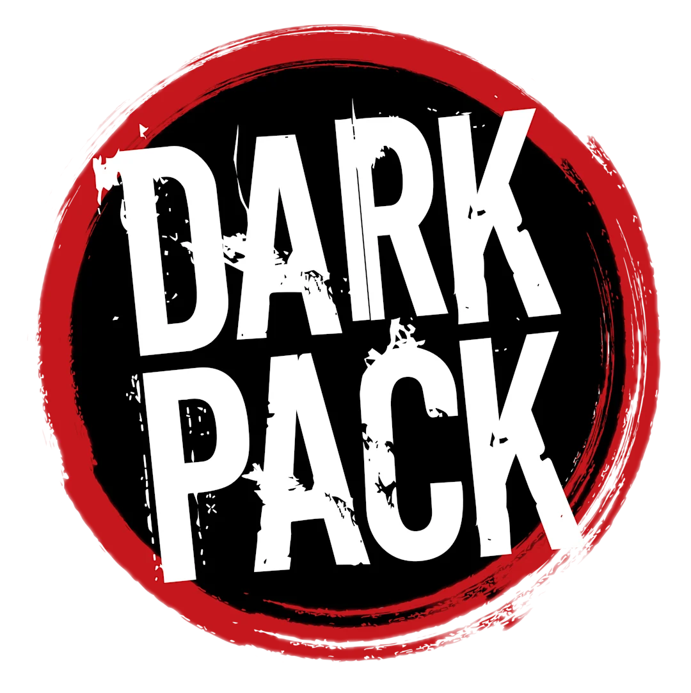

# Outils web pour MJ — Vampire : la Mascarade V5

Petits sites faits maison pendant une chronique VtM V5 (Chicago, puis Gary — 2026), pour la table et l'écran du MJ.
La chronique est terminée ; les outils restent ici, libres d'être repris, adaptés ou pillés par d'autres MJ.

Presque tout est en **HTML / CSS / JS sans compilation** : on forke le dépôt, on l'importe sur [Vercel](https://vercel.com) (ou n'importe quel hébergement statique), et c'est en ligne. Les outils marqués 📴 fonctionnent aussi hors ligne une fois chargés.

---

## 🛠️ Outils réutilisables

| Outil | Ce que ça fait |
|---|---|
| [battleground](https://github.com/ashteroash-sudo/battleground) 📴 | **Table de combat** : joueurs / ennemis, santé, soif, tours, duels, musique, pool d'ennemis génériques (sabbat, cartel, voyous…) et répertoire d'ennemis nommés exportable. |
| [Scene-Maker](https://github.com/ashteroash-sudo/Scene-Maker) 📴 | **Gestionnaire de scène** façon tuiles : fond + musique + zones cliquables, vue MJ / vue joueur, horloge de jeu, lien ouvert sur un second écran. |
| [fiche-de-perso](https://github.com/ashteroash-sudo/fiche-de-perso) 📴 | **Fiche de personnage V5** interactive : pistes de dégâts, soif, volonté, cases à cocher, export / import de la fiche. |
| [chasse](https://github.com/ashteroash-sudo/chasse) 📴 | **Outil de prédation** : lieux de chasse, proies, résonance du sang, PNJ, ambiance musicale. Données d'exemple pour Gary, à remplacer par les vôtres. |
| [carte-chicago](https://github.com/ashteroash-sudo/carte-chicago) 📴 | **Carte de terrain** à quartiers cliquables (Chicago et Gary) ; un dossier par quartier avec texte + images, facile à étendre à une autre ville. |
| [visions](https://github.com/ashteroash-sudo/visions) 📴 | **Visions malkaviennes** animées, à lancer pendant la partie ([démo](https://visions-bay.vercel.app)). |
| [r-sum-histoire](https://github.com/ashteroash-sudo/r-sum-histoire) 📴 | **Intro de séance** : écran « Cliquez pour commencer » et résumé animé de l'histoire jusque-là. |
| [tableau-de-liege](https://github.com/ashteroash-sudo/tableau-de-liege) | **Tableau de liège partagé** pour la coterie : persos, lieux, indices, pistes, notes privées ; connexions joueurs / MJ (Supabase). |
| [radio-CB](https://github.com/ashteroash-sudo/radio-CB) | **Scanner radio** : on cherche la bonne fréquence dans le grésillement pour capter un message ([démo](https://radio-cb.vercel.app)). |

## 🎭 Accessoires de la chronique

Faux sites que les joueurs « trouvaient » en jeu. Liés à mon scénario, mais utiles comme modèles ou inspiration.

| Accessoire | Ce que c'est |
|---|---|
| [Schrecknet](https://github.com/ashteroash-sudo/Schrecknet) | Faux SchreckNet : chat IA avec un Nosferatu (clé API Gemini requise). |
| [Nocturne-app](https://github.com/ashteroash-sudo/Nocturne-app) | Fausse appli de rencontre dont un vampire se sert pour chasser ([démo](https://nocturne-app-three.vercel.app)). |
| [Victime-t-l-phone](https://github.com/ashteroash-sudo/Victime-t-l-phone) | Téléphone d'une victime, à fouiller comme une preuve numérique. |
| [morgue](https://github.com/ashteroash-sudo/morgue) | Registre du médecin légiste du comté de Cook. |
| [CCTV](https://github.com/ashteroash-sudo/CCTV) | Salle de vidéosurveillance : grille de caméras + console de « hack ». |
| [Journal](https://github.com/ashteroash-sudo/Journal) | Archives d'un journal local du South Side. |
| [scoop-tv](https://github.com/ashteroash-sudo/scoop-tv) | Flash info d'une chaîne à scandales. |
| [Gallerie](https://github.com/ashteroash-sudo/Gallerie) | Site d'un importateur d'art, avec espace réservé. |
| [eclipse-frv](https://github.com/ashteroash-sudo/eclipse-frv) | Tableau interactif à examiner : on gratte la peinture, on le retourne… |
| [lakeshore-freight](https://github.com/ashteroash-sudo/lakeshore-freight) | Suivi de colis d'une société de transport ([démo](https://lakeshore-freight.vercel.app)). |
| [Vino-Veritas](https://github.com/ashteroash-sudo/Vino-Veritas) | Portail d'un négociant en spiritueux + cercle de dégustation, carte de visite à QR code (Supabase) ([démo](https://vino-veritas-one.vercel.app)). |
| [d-dale](https://github.com/ashteroash-sudo/d-dale) | Le Dédale : labyrinthe d'énigmes en chambres, pour une joueuse malkavienne. |
| [labyrinth](https://github.com/ashteroash-sudo/labyrinth) | Prologue jouable du Dédale, en couloir à la première personne. |

---

Contenu non officiel, créé par une fan, gratuit et non commercial, dans le cadre du [Dark Pack](https://www.paradoxinteractive.com/games/world-of-darkness/community/dark-pack-agreement). Ce n'est pas du matériel officiel World of Darkness.
Portions of the materials are the copyrights and trademarks of Paradox Interactive AB, and are used with permission. All rights reserved. For more information please visit [worldofdarkness.com](https://www.worldofdarkness.com).
